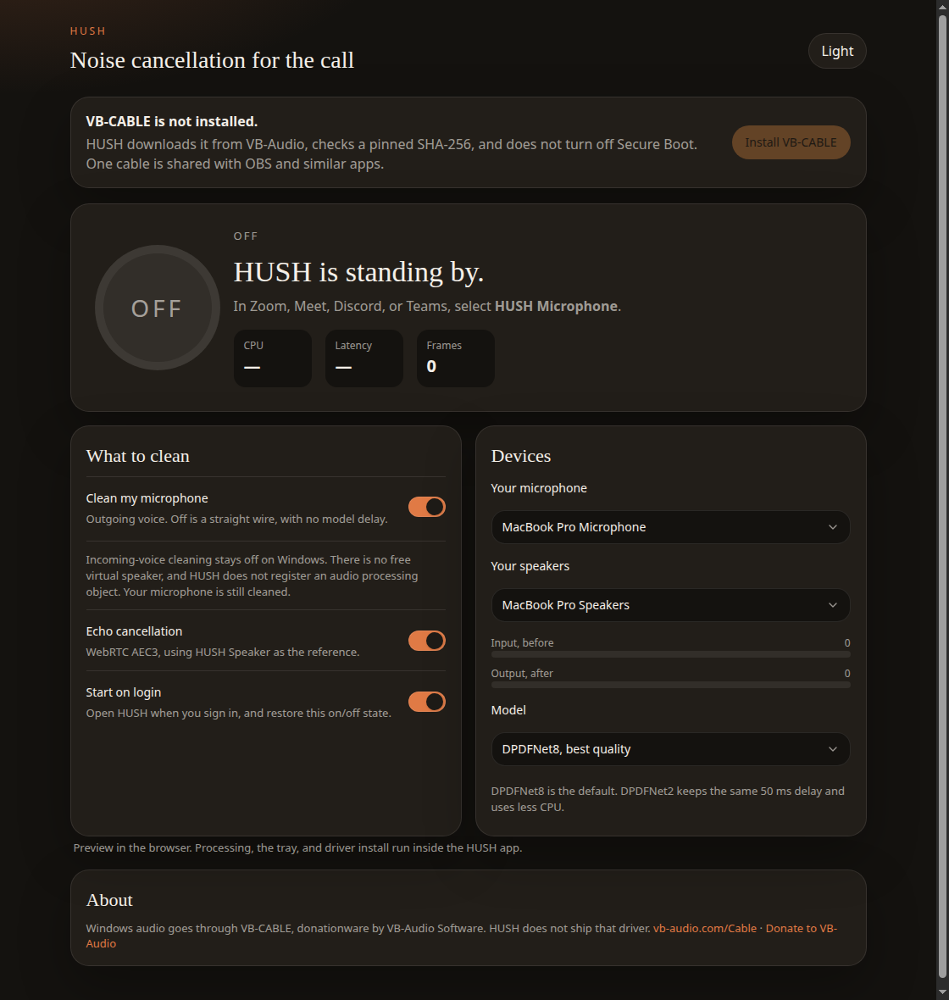

# HUSH

Real-time noise and echo cancellation for calls. The microphone path is WebRTC AEC3, then DPDFNet8. DeepFilterNet3 and RNNoise stay available when you want less delay or less CPU. A virtual microphone and a virtual speaker sit on top of that core on macOS. On Windows the same core feeds a virtual audio driver through a user-mode helper.

The call app should use **HUSH Microphone**. On a Mac it also uses **HUSH Speaker**. HUSH has to be running. Krisp is the product this is measured against. It is not part of HUSH.

## Install

### macOS

```bash
curl -fsSL https://raw.githubusercontent.com/psixsaba/HUSH/main/install.sh | bash
```

That downloads the newest app and `HUSH.driver`, installs both with one administrator prompt, runs `xattr -cr`, and restarts `coreaudiod` with `killall coreaudiod`. On macOS 15 Sequoia, if the app is blocked, try to open it, then use **System Settings > Privacy & Security > Open Anyway**. `uninstall.sh` removes the app and the plugin. Details are in [docs/MAC_TEST.md](docs/MAC_TEST.md).

### Windows

Download `HUSH_0.3.1_x64-setup.exe` and run it. Secure Boot stays on. There is no Test Mode step. The installer downloads VB-CABLE from VB-Audio, checks SHA-256 `b950e39f01af1d04ea623c8f6d8eb9b6ea5c477c637295fabf20631c85116bfb`, and runs VB-Audio's own setup. Reboot once if it asks. In Zoom, Meet, Discord, or Teams, select **HUSH Microphone**. VB-CABLE is donationware and is not shipped inside HUSH: [vb-audio.com/Cable](https://vb-audio.com/Cable/) and [donate](https://vb-audio.com/Services/donate.htm). Details are in [docs/WINDOWS_TEST.md](docs/WINDOWS_TEST.md).

The window has one ON/OFF switch. It remembers that state, and it can open at login.



The disk image and the package are still built for people who want them. The test-signed Windows driver is documented in [docs/DEVELOPER.md](docs/DEVELOPER.md).

## Layout

```
crates/hush-core     48 kHz pipeline, devices, shared-memory ring
crates/hush-ffi      C API (include/hush.h)
crates/hush-cli      hush clean, hush run, hush devices
apps/desktop         Tauri 2 shell
drivers/macos        libASPL AudioServerPlugIn
drivers/windows      virtual audio driver, IOCTL bridge, test-signing notes
native/ring          the ring, one implementation, macOS and Windows
bench                SI-SDR, STOI, DNSMOS P.835
```

Why these pieces, and not the others, is in [docs/DECISIONS.md](docs/DECISIONS.md).

## Licenses

The shipped code and weights are MIT, Apache-2.0, BSD-3-Clause, or MS-PL. Nothing GPL and nothing non-commercial is linked. PESQ is not included.

| Piece | License | Role |
| --- | --- | --- |
| This repository | MIT OR Apache-2.0 | Pipeline, CLI, app, plugin, harness |
| webrtc-audio-processing 2.1, bundled | BSD-3-Clause | AEC3 |
| deep-filter-rt 0.2 and DeepFilterNet3 weights | MIT OR Apache-2.0 | Noise removal on tract |
| nnnoiseless 0.5.2 (RNNoise) | BSD-3-Clause | Low-CPU fallback |
| tract (via deep-filter-rt) | MIT OR Apache-2.0 | ONNX runtime for DeepFilterNet3 |
| cpal, hound, rtrb | Apache-2.0 / MIT | Devices, WAV, realtime queues |
| libASPL 3.1.2 | MIT | macOS AudioServerPlugIn |
| Tauri 2, React, Radix | MIT OR Apache-2.0 | Desktop shell |
| numpy, scipy, soundfile, pystoi, onnxruntime | BSD / MIT | Benchmark only |
| DPDFNet and its ONNX weights | Apache-2.0 | Default noise removal. Downloaded, not committed |
| ort (ONNX Runtime) | MIT OR Apache-2.0 | Runs DPDFNet |
| DNSMOS P.835 model and scorer | MIT (Microsoft DNS Challenge) | Benchmark only, downloaded, not committed |
| Virtual Audio Driver | MIT / MS-PL | Windows driver, vendored |
| SysVAD (not vendored) | MS-PL | Windows reference sample |
| PESQ | ITU, not permissive | Do not add |

Linux links libasound from the system. That library is LGPL and is not shipped. macOS links Core Audio, which is the OS.

## Build

Rust stable (1.96 or newer; DeepFilterNet's crate asks for it). CMake, a C++ compiler, and Meson, because AEC3 builds the bundled C++ module with Meson.

### Linux

```bash
sudo apt-get install -y build-essential pkg-config libasound2-dev cmake clang meson ninja-build g++
export CC=gcc CXX=g++
# Some Clang installs cannot see libstdc++ headers. Bindgen needs them.
export BINDGEN_EXTRA_CLANG_ARGS="-cxx-isystem /usr/include/c++/13 -cxx-isystem /usr/include/x86_64-linux-gnu/c++/13"
cargo test -p hush-core -p hush-ffi -p hush-cli --release
cargo build -p hush-cli --release
```

### macOS

On a Mac with Xcode Command Line Tools and no Homebrew:

```bash
scripts/macos/dev-setup-and-test.sh
sudo scripts/macos/install-driver.sh
./target/release/hush selftest
```

The setup script installs rustup, CMake, Meson, and Ninja under the home directory, downloads the DPDFNet8 weights into `~/.cache/dpdfnet`, builds the core, the arm64 HAL plugin, and the CLI, and runs the Rust tests. It does not install the driver. `HUSH_UNIVERSAL=1 drivers/macos/build.sh` adds an Intel slice. The call-app steps are [docs/MAC_TEST.md](docs/MAC_TEST.md).

If CMake, Meson, and Ninja are already installed, the same builds are:

```bash
cargo build -p hush-cli -p hush-desktop --release
drivers/macos/build.sh
sudo scripts/macos/install-driver.sh
```

Unsigned package and disk image, after the driver and the release CLI exist:

```bash
mkdir -p dist
scripts/macos/build-unsigned-pkg.sh
scripts/macos/build-unsigned-dmg.sh
```

`pkgbuild` and `hdiutil` are macOS tools. They were not run in the environment that produced this tree.

The desktop UI, from `apps/desktop`:

```bash
npm install
npm run dev          # http://127.0.0.1:43123  preview, no audio engine
npm run tauri dev    # the shell, wired to the core
```

### Windows

The installable build is the pre-release `v0.1.0-windows-test`. The steps, including test signing and Secure Boot, are [docs/WINDOWS_TEST.md](docs/WINDOWS_TEST.md).

```powershell
# Rust stable, Visual Studio Build Tools, Meson, Ninja, and the WDK for the driver.
cargo test -p hush-core -p hush-ffi -p hush-cli --release
cargo build -p hush-cli --release
drivers\windows\install-wdk.ps1
drivers\windows\build-driver.ps1
cd apps\desktop
npm ci
$env:HUSH_DRIVER_DIR = "..\..\dist\driver"
npm run tauri build
```

`hush service` copies the shared-memory rings through `\\.\HushVad` in the interactive session. The installer also starts that process at login. GitHub Actions installs the WDK, compiles the driver, test-signs it, and builds the NSIS and MSI packages. The runner does not load the `.sys`.

## Use

```bash
hush devices
hush clean --input bench/examples/noisy.wav --output /tmp/clean.wav --json /tmp/clean.json
hush clean --input bench/examples/echo_near.wav --far bench/examples/far.wav --aec --output /tmp/echo.wav
hush run --ns rnnoise                 # live mic, prints one line per 10 ms frame
hush run --bridge --output "Headphones"
```

`--ns` is `dpdfnet` (default), `dpdfnet2`, `deepfilter`, `rnnoise`, `target-speaker`, or `off`. `target-speaker` refuses to start. The training plan is [docs/TARGET_SPEAKER.md](docs/TARGET_SPEAKER.md). `--strength 0` skips the suppressor and its delay. Strength 1 is the model's full attenuation. `--clean-incoming true` (the default on `hush run`) denoises HUSH Speaker before playback and uses that signal as the echo reference.

The DPDFNet ONNX files are not in git. `dpdfnet download dpdfnet8_48khz_hr` and `dpdfnet download dpdfnet2_48khz_hr` put them in `~/.cache/dpdfnet/models/`. `HUSH_DPDF_ONNX` and `HUSH_DPDF_ONNX_2` override those paths.

`hush run` prints processing time and CPU for each frame. CPU is that time divided by the 10 ms frame.

## Benchmark

```bash
python3 -m venv bench/.venv
bench/.venv/bin/pip install -r bench/requirements.txt
python3 bench/make_examples.py
cargo build -p hush-cli --release
bench/.venv/bin/python bench/harness.py
```

The harness writes `bench/results/latest.json`. It reports SI-SDR, STOI, and DNSMOS P.835 (SIG, BAK, OVRL), plus the CLI's latency and CPU. How to fetch DNS Challenge and VoiceBank-DEMAND, and why PESQ is absent, is [docs/DATASETS.md](docs/DATASETS.md).

## What a real Mac or PC still has to prove

This tree was built and measured on Linux. It was not loaded into coreaudiod, not signed, and not run through Zoom.

On a Mac:

- `HUSH_UNIVERSAL=1 drivers/macos/build.sh` produces `HUSH.driver`.
- After install, `system_profiler SPAudioDataType` should list HUSH Microphone and HUSH Speaker. `hush selftest` checks that, the ring, and per-frame CPU. The Mac steps are [docs/MAC_TEST.md](docs/MAC_TEST.md).
- Start HUSH, select the pair in a call, and confirm the other side hears the cleaned mic and you hear them.
- Re-measure CPU on Apple Silicon. The default here is DPDFNet8. The budget used on this machine is a p95 frame under 8 ms. One hop was 3.2 ms.

On a PC, after the GitHub Actions build:

- Install from the `v0.1.0-windows-test` release with test signing on. The steps are [docs/WINDOWS_TEST.md](docs/WINDOWS_TEST.md).
- `hush selftest` checks the ring, per-frame CPU, both endpoints, and a tone through the driver in each direction.
- Start HUSH, select the pair in Zoom, Meet, Discord, or Teams, and confirm the other side hears the cleaned mic and you hear them.
- Attestation signing needs an EV certificate and a Partner Center account. HLK is separate and was not run.

VoiceBank-DEMAND test set, all 824 files, 48 kHz. The WAVs are not in git. PESQ is wideband at 16 kHz and is an internal number only. DNSMOS is P.835. DPDFNet2 and the 16 kHz rows were scored with the Python causal stream, aligned by the measured lag. DPDFNet8, RNNoise, and DeepFilterNet3 are the Rust pipeline. On `p232_001` the Rust DPDFNet8 stream matches that Python stream at correlation 1.000, and Rust DPDFNet2 at the same 50 ms shift is SI-SDR 22.49.

| System | SI-SDR | STOI | PESQ | SIG | BAK | OVRL | Frame cost |
| --- | ---: | ---: | ---: | ---: | ---: | ---: | --- |
| Noisy | 8.39 dB | 0.921 | 1.97 | 3.32 | 3.11 | 2.68 | |
| DPDFNet8 48 kHz | 18.86 dB | 0.942 | 2.94 | 3.40 | 4.12 | 3.18 | 3.2 ms p95, 50 ms delay |
| DPDFNet2 48 kHz | 18.88 dB | 0.939 | 2.98 | 3.38 | 4.05 | 3.12 | 1.5 ms p95, same 50 ms |
| DPDFNet8 16 kHz | 18.59 dB | 0.922 | 2.59 | 3.42 | 4.14 | 3.20 | 40 ms group delay, not shipped |
| DPDFNet2 16 kHz | 18.38 dB | 0.920 | 2.58 | 3.42 | 4.14 | 3.20 | 40 ms group delay, not shipped |
| RNNoise | 12.90 dB | 0.917 | 2.28 | 3.33 | 3.83 | 2.98 | 0.06 ms p95, 10 ms delay |
| DeepFilterNet3 (tract) | 8.89 dB | 0.840 | 1.92 | 2.95 | 3.82 | 2.66 | 0.63 ms p95, 30 ms delay |

DPDFNet8 stays the default. DPDFNet2 is the same delay at about half the CPU and a slightly lower DNSMOS score, so it is a setting, not the default, and not a low-latency mode. No export in the library has a window shorter than 20 ms. The first Python hop really does come back after that window, and the speech is still 40 ms behind. Our frame API adds the 10 ms spent filling the window, which is the 50 ms we report. Prefilling the window did not remove it. DeepFilterNet3 at 30 ms and RNNoise at 10 ms are the shorter delays, and neither stays near DPDFNet8 on this set. Incoming cleaning runs a second copy of the selected model. Two DPDFNet8 hops are about 6.4 ms on this machine.

The DNS Challenge blind set was not scored. The official archives are multi-gigabyte and are not in the git repository. A synthetic-vowel clip is still generated by `bench/make_examples.py` for a smoke test. Those STOI and SIG numbers are not a model ranking.

AEC3 plus DeepFilterNet3 on the synthetic echo clip: 5.5% CPU mean, 7.2% p95. A pure 80 ms echo in the unit test lost more than 8 dB in the last half second.
